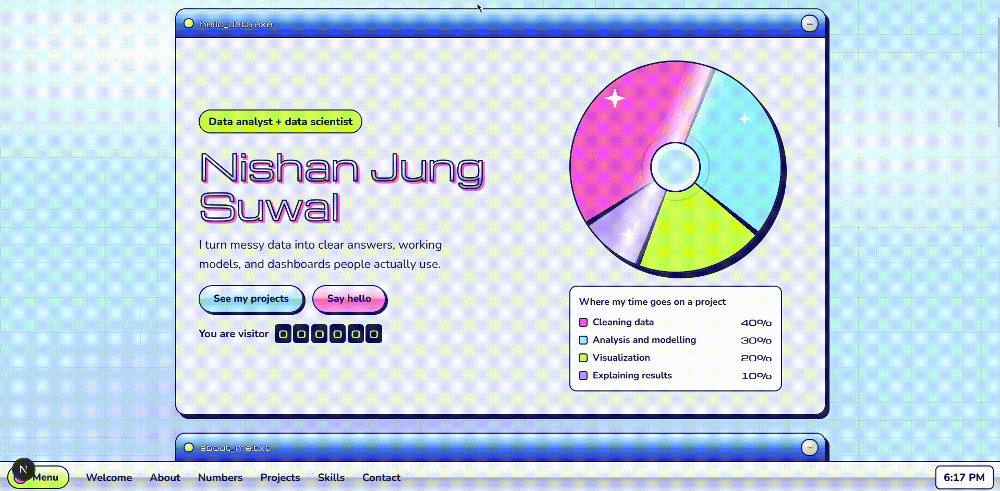

# Nishan Jung Suwal | Portfolio

My personal portfolio: a Y2K-style site showing my data analytics and data science projects.

**Live site:** [[https://your-site.vercel.app](https://zungazzz-github-io.vercel.app/)]

## What's inside

- A hero with a donut chart, drawn from data with CSS and no chart library
- A spreadsheet-style table of my numbers
- Project cards with SVG line charts and headline metrics
- Keyboard-friendly navigation, and animations that stop for visitors who prefer reduced motion(toggeled via animation effects in windows settings)

## Built with

Next.js (App Router), React, and plain CSS. Deployed on [Vercel].

## Run it locally

    git clone https://github.com/Zungazzz/zungazz.github.io
    cd zungazz.github.io
    npm install
    npm run dev

Then open http://localhost:3000.

## Edit the content

All text and numbers live in `data/content.js`. Colours are variables at the top of `app/globals.css`.

## Contact

[nishanjungsuwal@gmail.com] · [https://www.linkedin.com/in/nishan-jung-suwal-519279238/] · ["https://github.com/Zungazzz]